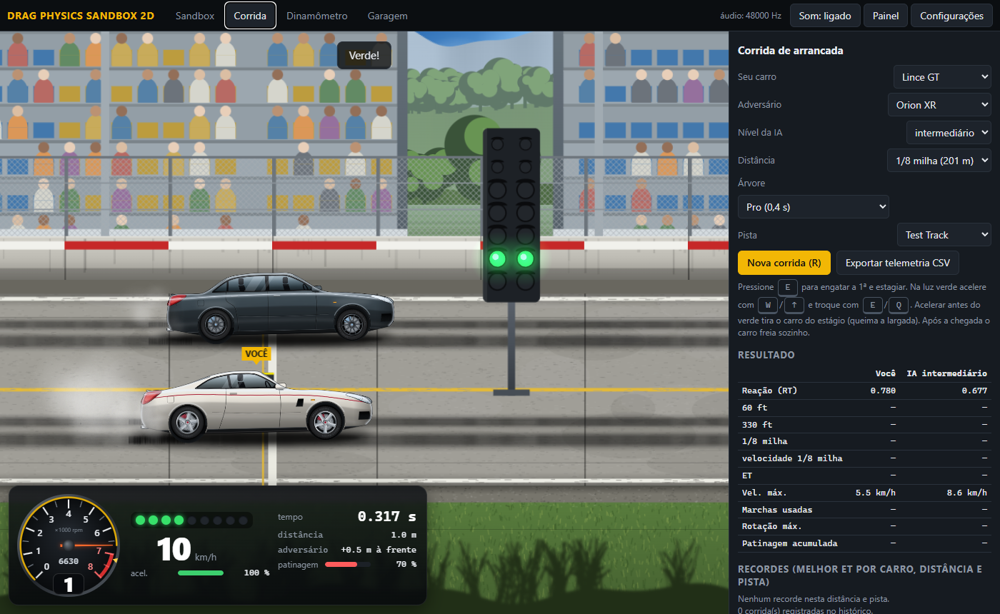
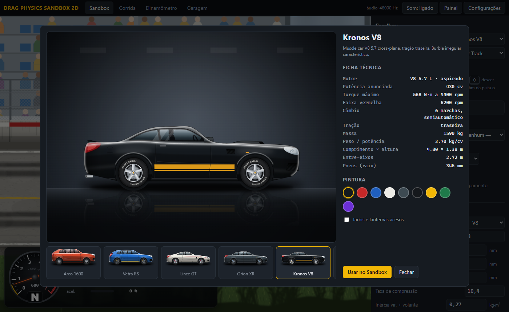

# Drag Physics Sandbox 2D

Jogo de arrancada em vista lateral 2D, feito para o navegador, com:

- **física própria** de passo fixo (1/120 s): motor de valor médio, embreagem e câmbio semiautomático simulados, pneus Magic Formula e transferência de carga;
- **som 100 % sintetizado** a partir do estado da física: guias de onda acústicas e escapamento por cilindro, em um AudioWorklet;
- **gráficos 2D semirrealistas** gerados por código: carros com desenho próprio e materiais, rodas e suspensão animadas pela física, pista texturizada, cenários em camadas com parallax e iluminação de dia, fim de tarde e noite.



Nada de amostras gravadas e nada de números de desempenho impostos. A potência medida no dinamômetro, os tempos de corrida e o som saem das mesmas equações.

O código porta e corrige partes de dois projetos MIT, [engine-sim](https://github.com/ange-yaghi/engine-sim) e [engine-sound-generator](https://github.com/Antonio-R1/engine-sound-generator). Os commits exatos e o que foi alterado estão em [docs/OPEN_SOURCE_INTEGRATION.md](docs/OPEN_SOURCE_INTEGRATION.md).

## Início rápido

Requisitos: Node.js 22.12 ou mais recente (exigido pelo Vite 8). Os testes E2E usam o Microsoft Edge instalado no sistema.

```bash
npm install
```

```bash
npm run dev
```

Abra o endereço que o Vite mostrar e clique em **Ativar som e começar**: o navegador só libera áudio após uma interação.

| Comando | O que faz |
|---|---|
| `npm run dev` | servidor de desenvolvimento (Vite) |
| `npm run build` | checagem de tipos + build de produção em `dist/` |
| `npm run preview` | serve o build de produção |
| `npm test` | testes unitários e de integração (Vitest) |
| `npm run test:e2e` | testes ponta a ponta no Edge, contra o servidor de desenvolvimento |
| `npm run test:e2e:build` | os mesmos testes contra o build de produção |
| `npm run bench` | benchmark de física e áudio (Node) |
| `npm run assets` | exporta as camadas SVG da arte de cada carro e um manifesto com os metadados visuais para `dist-assets/sprites` |
| `npm run calibrate:audio` | recalibra os fatores de escala Pa → saída digital do áudio |

## Controles

Câmbio semiautomático: **não há tecla de embreagem nem de freio**.

| Tecla | Ação |
|---|---|
| `W` / `↑` | acelerador (segure; o pedal sobe em ~90 ms, ajustável) |
| `E` | subir marcha |
| `Q` | descer marcha |
| `R` | reiniciar a simulação / correr de novo |
| `P` / `Esc` | pausar |
| `C` | câmera (seguir / os dois carros / largada) |
| `T` | mostrar ou ocultar o Developer Lab |
| `M` | mudo |

- **Embreagem e ignição:** a embreagem é automática e fisicamente simulada; a ignição liga sozinha ao entrar na pista.
- **Depois da chegada:** o carro freia automaticamente, ou você pode reiniciar.
- **Teclas:** todas são remapeáveis em **Configurações**.
- **Gráficos:** em **Configurações** há três perfis gráficos (baixo, médio, alto) e a escolha da iluminação (padrão da pista, dia, fim de tarde ou noite).
- **Telas de toque:** aparecem botões na tela; eles podem ser forçados a aparecer ou sumir em Configurações.

Detalhes em [docs/CONTROLS.md](docs/CONTROLS.md).

## Modos

### Sandbox

Escolha carro e pista e dirija livremente. A partir do painel você também pode:

- editar o carro (motor, câmbio, pneus e chassi, escapamento) com validação;
- mudar as condições da pista ao vivo;
- comparar com um segundo carro, que espelha seus comandos ou é guiado pela IA;
- salvar presets;
- usar o mixer por canal de som;
- abrir o **Developer Lab**: gráficos em tempo real, contadores medidos, passo a passo e exportação CSV.

Mais em [docs/SANDBOX.md](docs/SANDBOX.md).

### Corrida

Arrancada contra a IA (iniciante, intermediário ou avançado).

- **Distâncias:** 1/8 de milha, 1/4 de milha ou 1 km.
- **Árvore:** pro ou sportsman.
- **Resultados:** tempo de reação (RT), parciais de 60/330/1000 ft, ET e velocidades de trap. O cartão também mostra marchas usadas, rotação máxima e patinagem acumulada.
- **Recordes e histórico:** ficam no IndexedDB.

### Dinamômetro

Varredura em plena carga, em que o torque é **medido** pelo freio do dinamômetro e nunca lido da curva configurada, com exportação CSV.

A bancada ao vivo tem som e mostra espectro e oscilograma. Dá para trocar o escapamento e fixar um espectro de referência para comparar. O carro aparece numa célula de testes, sobre os rolos, ao lado dos gráficos medidos.

### Garagem

O botão **Garagem** abre uma prévia grande de cada carro em estúdio, com ficha técnica, amostras de pintura e luzes. O carro e a cor escolhidos valem para o modo que estiver aberto.



## Conteúdo

| Carro | Motor | Indução | Tração |
|---|---|---|---|
| Arco 1600 | 1,6 L I4 16V | aspirado | dianteira |
| Vetra RS | 2,0 L I4 | turbo | dianteira |
| Lince GT | 3,5 L V6 60° | aspirado | traseira |
| Orion XR | 3,0 L I6 | turbo | traseira |
| Kronos V8 | 5,7 L V8 cross-plane | aspirado | traseira |
| Tempest V8 | 4,0 L V8 flat-plane | aspirado | traseira |
| Aurora V12 (lab) | 6,5 L V12 | aspirado | traseira |

Todos os carros são fictícios. O Aurora V12 é um carro de laboratório e só aparece no Sandbox e no dinamômetro.

| Pista | Condições |
|---|---|
| Test Track | 24 °C, 101,3 kPa |
| Desert Strip | 38 °C, 95,5 kPa, vento contra, aderência 0,92 |
| Night Industrial | 15 °C, noite |
| Airfield | 2 km, vento a favor |

## Documentação

- [Arquitetura](docs/ARCHITECTURE.md)
- [Modelo físico](docs/PHYSICS_MODEL.md): equações, parâmetros, unidades e hipóteses
- [Modelo acústico](docs/ACOUSTIC_MODEL.md): o que é validado matematicamente e o que exigiria calibração real
- [Sistema visual](docs/VISUAL_SYSTEM.md): pipeline de arte, animações, pista, cenários, câmera, instrumentos e perfis gráficos
- [Integração open source](docs/OPEN_SOURCE_INTEGRATION.md)
- [Controles](docs/CONTROLS.md) · [Sandbox](docs/SANDBOX.md) · [Testes](docs/TESTING.md)
- [Limitações conhecidas](docs/LIMITATIONS.md)

## Licença

MIT, ver [LICENSE](LICENSE). As licenças de terceiros estão em [LICENSES/](LICENSES) e em [THIRD_PARTY_NOTICES.md](THIRD_PARTY_NOTICES.md).
