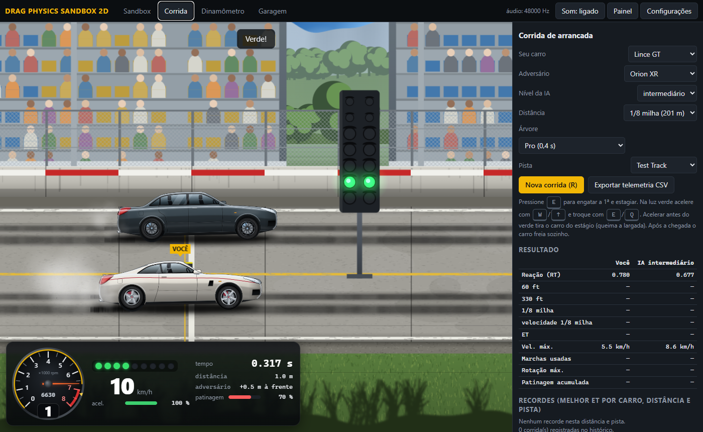
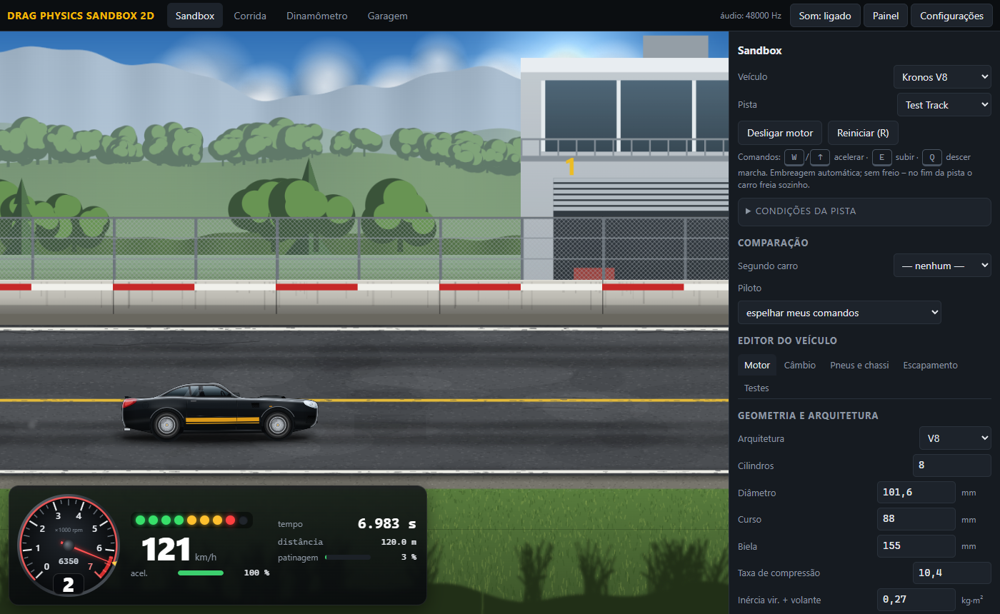
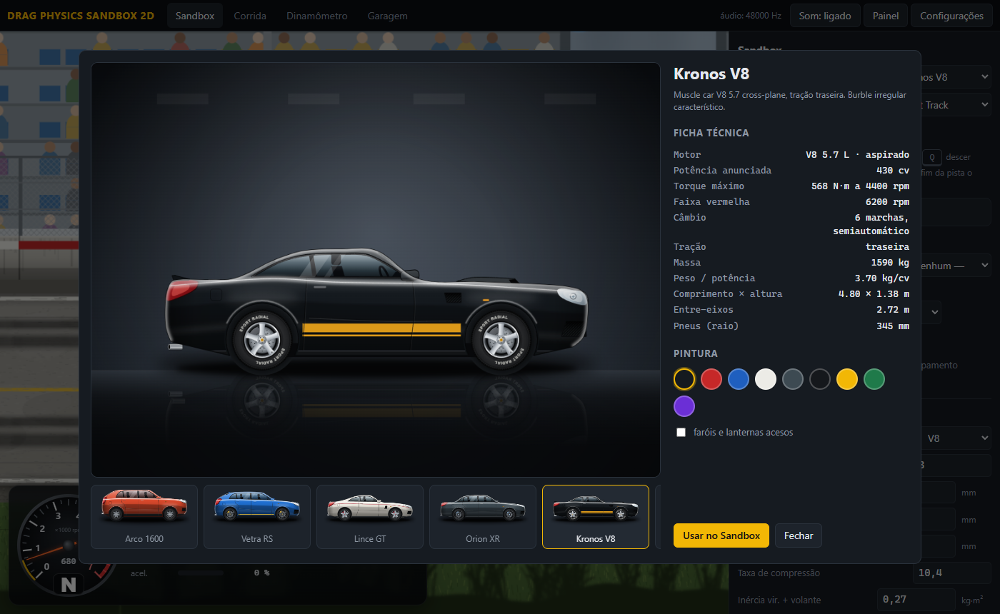

# Sistema visual

Este documento descreve a camada de renderização e interface depois da reformulação gráfica: o que existia, o que foi substituído, como a arte é produzida e como cada componente usa os dados da física.

A regra que organiza tudo: **a física fornece o estado, o visual apenas interpreta e desenha**. Nenhum componente visual escreve torque, rotação, velocidade ou aderência. O áudio continua recebendo os mesmos quadros da física de antes; nada nele foi alterado.



## 1. Auditoria do estado anterior

| Parte | Como era | Decisão |
|---|---|---|
| Arte dos carros (`carArt.ts`) | um SVG por carro feito de polígonos e retângulos, seis perfis, rodas com raios em linha | **substituída** pelo pipeline em camadas (seção 3) |
| Texturas | duas por carro, nunca liberadas ao trocar ou editar o carro | **substituída** por um atlas por carro com contagem de referências |
| Cena (`RaceScene.ts`) | um arquivo de 736 linhas com câmera, adereços, partículas e pista juntos | **dividida** em componentes; a cena virou um orquestrador |
| Pista e cenário (`trackArt.ts`) | asfalto 512 × 120 com ruído, três faixas de parallax em polígonos chapados | **substituídos** por texturas detalhadas e camadas com névoa de distância |
| Partículas | emissores do Phaser; fumaça por velocidade de escorregamento; pulsos de escape constantes | **substituídas** por um pool próprio, com fumaça só quando o pneu desliza |
| HUD (`Hud.ts`) | arco simples, marcha e velocidade em caixas separadas, uma luz de troca | **substituído** por instrumentos (seção 9) |
| Garagem | não existia | **criada** |
| Dinamômetro | só os gráficos | **ganhou** a ilustração da bancada, mantendo os gráficos reais |
| Contrato cena ↔ física (`SceneBridge`, `VehicleViews`) | a cena só lê | **mantido** e ampliado com mais leituras |
| Escala do mundo (40 px/m, duas faixas com deslocamento vertical) | — | **mantida** |
| Marcador "VOCÊ" e indicador do adversário fora da tela | — | **mantidos** |

A migração foi feita com o jogo funcionando a cada passo: a arte nova foi validada primeiro numa folha de contato separada (`?artsheet`), depois a cena foi trocada de uma vez, com o contrato da ponte preservado.

## 2. Arquitetura

```
VehicleSimulation ──► VehicleViews (adaptador, só leitura) ──► RenderVehicle
                                                                   │
RaceScene (orquestrador) ◄── SceneBridge ◄── modo ativo            │
   ├─ LightingController      dia / fim de tarde / noite           │
   ├─ CameraController        posição, zoom, linha do solo         │
   ├─ ParallaxEnvironment     céu, nuvens, 3 camadas, campo        │
   ├─ TrackRenderer           asfalto, muro, estruturas, árvore    │
   ├─ VehicleVisualController × N  ◄────────────────────────────────┘
   │     ├─ VehicleSpriteAssembler   (atlas do carro)
   │     ├─ WheelAnimationController (desfoque por velocidade da roda)
   │     └─ SuspensionVisualController (arfagem e afundamento)
   └─ VehicleParticleSystem   fumaça, marcas, poeira, detritos

RacingHUD ── Tachometer, GearIndicator, ShiftLights     (DOM + canvas)
GarageDialog ── GarageVehiclePreview                    (mesmo atlas)
DynoBayView                                             (mesmo atlas)
```

| Componente do plano | Arquivo |
|---|---|
| `VehicleVisualController` | `src/game/vehicles/VehicleVisualController.ts` |
| `VehicleSpriteAssembler` | `src/game/vehicles/VehicleSpriteAssembler.ts` e `src/game/vehicles/art/` |
| `WheelAnimationController` | `src/game/vehicles/WheelAnimationController.ts` |
| `SuspensionVisualController` | `src/game/vehicles/SuspensionVisualController.ts` |
| `VehicleParticleSystem` | `src/game/vehicles/VehicleParticleSystem.ts` |
| `TrackRenderer` | `src/game/scenes/TrackRenderer.ts` |
| `ParallaxEnvironment` | `src/game/scenes/ParallaxEnvironment.ts` |
| `CameraController` | `src/game/scenes/CameraController.ts` |
| `LightingController` | `src/game/scenes/LightingController.ts` |
| `RacingHUD` | `src/ui/hud/RacingHUD.ts` |
| `Tachometer` | `src/ui/hud/Tachometer.ts` |
| `GearIndicator` | `src/ui/hud/GearIndicator.ts` |
| `GarageVehiclePreview` | `src/ui/garage/GarageVehiclePreview.ts` |

Os controladores de roda, suspensão, câmera, iluminação e instrumentos são lógica pura (sem Phaser nem DOM) e têm testes unitários.

## 3. Pipeline de arte dos veículos

```
CarConfig (dimensões reais, cores)
   └► desenho da carroceria (art/designs.ts: um por modelo)
        └► camadas SVG  (art/bodyArt.ts, art/wheelArt.ts)
             └► rasterização única, na resolução do perfil gráfico
                  └► atlas de textura com 11 quadros + metadados
                       └► pista, garagem e dinamômetro
```

- **Autoria em SVG gerado por código.** O plano permite SVG como formato de autoria desde que a arte seja detalhada. Não há Blender nem arquivos de imagem: o pipeline é totalmente reproduzível, e a mesma configuração sempre gera os mesmos arquivos.
- **Um desenho por modelo.** Os oito carros têm silhueta, vidros, cortes de porta, faróis, lanternas, aerodinâmica e rodas próprios. Um teste garante que nenhum par compartilha a silhueta.
- **Carro real (Gol GTS 1988, `golGts88`).** O desenho usa alguns recursos opcionais do formato de desenho, que nenhum carro fictício usa:
  - `lowerTrim`: para-choques envolventes e molduras laterais escuras, com friso;
  - `badges`: emblema de texto, aqui "GTS";
  - `cornerLamp`: pisca dianteiro;
  - `tailRibs`: nervuras da lanterna;
  - aerofólio `hatchLip` no topo da tampa traseira;
  - roda `teardrop` ("Pingo d'Água") com número de parafusos (`lugs`), disco liso (`discDrilled: false`) e tambor traseiro (`rearBrake: 'drum'`).

  As proporções vêm das dimensões do manual. Ver [vehicles/vw-gol-gts-1988.md](vehicles/vw-gol-gts-1988.md).
- **Geometria real.** Os desenhos são normalizados e esticados para o comprimento e a altura de cada carro; as caixas de roda são recortadas na posição real dos eixos e com o raio real do pneu. Um carro editado no Sandbox continua coerente com a física.
- **Exportação:** `npm run assets` grava as 9 camadas SVG de cada carro e um `manifest.json` com os metadados em `dist-assets/sprites`.
- **Folha de contato:** abrir o jogo com `?artsheet` mostra todos os carros lado a lado; `?artsheet=night` mostra as luzes acesas.

### Camadas do atlas

| Quadro | Conteúdo | Uso |
|---|---|---|
| `shadow` | sombra de contato difusa | sob o carro, não acompanha a suspensão |
| `under` | caixas de roda, assoalho, ponteiras | atrás das rodas |
| `hub` | disco de freio e pinça do eixo dianteiro | parado, atrás da roda |
| `hubRear` | freio do eixo traseiro: igual a `hub`, ou um tambor quando o desenho pede `rearBrake: 'drum'` | parado, atrás da roda traseira |
| `wheel` | pneu e aro, transparente entre os raios | gira |
| `wheelSoft`, `wheelFull` | a roda com desfoque de rotação leve e total | geradas a partir de `wheel` |
| `body` | pintura, painéis, vidros, faróis, frisos | sobre as rodas |
| `gloss` | só os brilhos, em branco | tingido com a cor do céu |
| `lights` | faróis e lanternas acesos | aditivo |
| `brake` | luz de freio | aditivo |

### Materiais

- **Pintura:** gradiente vertical, linha de horizonte refletida na lateral, faixa de luz no ombro, escurecimento nas extremidades e volume sobre os para-lamas. Os brilhos ficam numa camada separada, tingida pela cor do céu da cena.
- **Vidros:** semitransparentes, com o cenário passando atrás, bancos e volante em silhueta, reflexos diagonais e borracha de vedação.
- **Metais:** aros com gradiente por raio, borda polida, cromados nas ponteiras.
- **Pneus:** borracha fosca em gradiente radial, ombro com sulcos, letras na lateral.
- **Faróis e lanternas:** lente, refletor e, acesos, halo aditivo.

### Metadados visuais

Cada conjunto de sprites carrega, em metros e relativo ao contato do eixo dianteiro com o solo: comprimento, altura, entre-eixos, centro de cada roda, raio do pneu, posição das ponteiras, dos faróis e das lanternas, pontos de contato dos pneus (onde nascem fumaça e marcas), altura do solo e centro visual do corpo. Um teste confere esses valores contra a configuração física de cada carro.

## 4. Rodas e pneus

- **Rotação:** o ângulo de cada roda é o integrado pela física para aquele eixo. As rodas motrizes seguem a linha de tração e as livres seguem a velocidade do carro. O rpm do motor não é usado. Numa patinagem a roda motriz gira visivelmente mais rápido que o carro anda.
- **Desfoque progressivo:** nítida até 9 rad/s, desfoque leve entre 9 e 20 rad/s, desfoque total entre 24 e 46 rad/s. Em cada transição a camada de baixo fica opaca até a de cima estar completa, para a roda nunca ficar translúcida.
- **Pinça parada:** o disco e a pinça ficam num quadro que não gira, visível entre os raios.
- **Contato com o solo:** as rodas ficam sempre a um raio do solo. É a carroceria que se move sobre elas.

## 5. Animações mecânicas

`SuspensionVisualController` é uma mola amortecida (1,5 Hz, amortecimento 0,55) excitada pela aceleração longitudinal da física:

```
arfagem alvo  = 0,26 · (h_CG / entre-eixos) · a / g        (limite ±0,075 rad)
afundamento   = −0,0011 · |a| − 4·10⁻⁶ · v²                (limite 0,045 m)
```

| Situação | O que se vê | De onde vem |
|---|---|---|
| marcha lenta | vibração sutil, maior com menos cilindros | estado do motor e rotação |
| partida | tremor mais forte | estado `CRANKING` |
| aceleração | frente sobe, traseira afunda | aceleração da física |
| troca de marcha | a carroceria cai e volta | queda da aceleração durante a troca |
| patinagem | roda gira mais rápido, fumaça, marcas | escorregamento da física |
| desaceleração | frente desce, movimento amortecido | aceleração negativa |
| frenagem automática | luz de freio | comandos `autoBrake` / `holdBrake` |

A suspensão visual não devolve nenhuma força à física.

## 6. Partículas

`VehicleParticleSystem` usa um pool de sprites de um único atlas, com limite por perfil gráfico.

- **Fumaça dos pneus:** só existe quando há **deslizamento real**: razão de escorregamento acima de 0,18 **e** velocidade de escorregamento acima de 1 m/s. Acelerar em ponto morto ou tracionar no limite de aderência não produz fumaça. Intensidade, tamanho, transparência e duração crescem com o deslizamento. A fumaça nasce no pneu motriz, é lançada para trás e depois é levada pelo vento da pista.
- **Escape:** discreto. Há um sopro na partida, durante o arranque, num degrau brusco de carga e nos estouros; não há nuvem constante.
- **Marcas de pneu:** decalques com duas trilhas (pneu de perto e de longe), limite de quantidade e vida de 28 a 42 s.
- **Poeira:** só na pista do deserto, acima de 8 m/s.
- **Detritos de borracha:** só no perfil alto e com patinagem forte.

## 7. Pista

- **Asfalto:** textura com granulação, manchas de desgaste, trincas, remendo, borracha nos trilhos dos pneus, faixas laterais brancas e central amarela com desgaste.
- **Pad de concreto** na largada, com juntas de dilatação e borracha mais carregada.
- **Detalhes da largada:** caixa de água, linha de pré-estágio, linha de largada e sensores de cronometragem.
- **Estruturas:** muro de concreto com alambrado, arquibancadas com público, boxes, torre de controle, hangares, postes de luz, placas, placas de distância, banner e xadrez de chegada, caixa de areia e barreira de pneus no fim.
- **Árvore de largada:** fica entre as faixas, e as lâmpadas acesas vêm do estado real do `RaceController`. Enquanto o carro está na linha, a câmera a mantém em quadro.
- **Duas faixas:** separadas na vertical. O carro de longe fica mais alto e 8 % menor, com posição longitudinal e distância relativa reais.

## 8. Cenário, parallax e iluminação

| Camada | Velocidade relativa à pista |
|---|---|
| estrelas | 0,004 |
| nuvens | 0,012, mais deriva lenta |
| distante (serras, mesas, skyline) | 0,035 |
| média (colinas, dunas, fábricas, hangares) | 0,09 |
| próxima (vegetação, cercas, contêineres) | 0,22 |
| pista e estruturas | 1 |
| primeiro plano desfocado | 1,7 |

As texturas são periódicas na largura, sem emenda. A distância é sugerida por névoa, que reduz o contraste e aproxima as cores do horizonte.

`LightingController` tem três estados, e cada pista tem o seu padrão:

| | Dia | Fim de tarde | Noite |
|---|---|---|---|
| intensidade da luz | 1,0 | 0,86 | 0,60 |
| faróis e lanternas | apagados | acesos | acesos |
| postes da pista | apagados | acesos | acesos |
| sombra de contato | forte | deslocada e alongada | suave |
| reflexos do carro | cor do céu | quentes | frios e mais fracos |
| estrelas | não | poucas | sim |

Padrão por pista: Test Track e Airfield de dia, Desert Strip ao fim de tarde, Night Industrial à noite. Em **Configurações → Iluminação** é possível fixar qualquer um dos três.

## 9. Câmera

- **Enquadramento:** parado, a vista tem 14 m de largura, e o carro ocupa cerca de um terço. A linha do solo fica a 70 % da altura.
- **Zoom dinâmico:** abre até 21 m a 60 m/s.
- **Antecipação:** a câmera olha à frente do carro, até um quinto da vista.
- **Sem atraso:** a câmera anda junto com o carro e só então suaviza a diferença.
- **Adversário próximo:** a menos de 16 m, a vista abre o suficiente para manter os dois. Além disso, um indicador na borda mostra nome e distância.
- **Cortes:** só quando o carro volta à linha de largada.
- **Limites:** nunca mostra antes de −30 m nem depois do fim da pista.
- **Zoom do usuário:** multiplicador de 0,6× a 1,6× em Configurações.

## 10. Instrumentos



- **Conta-giros:** analógico, 270°. O topo da escala é o primeiro milhar acima do limitador de cada motor, e a zona vermelha começa na faixa vermelha daquele motor. Um marcador âmbar mostra o ponto de troca da marcha atual.
- **Marcha:** N, 1 a 6 e, durante a troca, a marcha sendo engatada com uma seta.
- **Velocidade:** dígitos grandes, em km/h ou mph.
- **Luzes de troca:** nove, progressivas. O alvo de cada marcha é a rotação em que a marcha seguinte passa a ter mais força na roda, calculada pela curva de torque e pelas relações de cada carro. Na última marcha ficam apagadas.
- **Demais leituras:** acelerador, turbo (quando existe), tempo, distância, diferença para o adversário e patinagem.

O ponteiro e os dígitos de velocidade passam por um filtro visual curto (35 e 60 ms). O valor físico não é alterado.

## 11. Garagem e dinamômetro



- **Garagem** (botão no topo): carro grande num estúdio com reflexo no piso, miniaturas de toda a frota, ficha técnica lida da configuração real, amostras de pintura e luzes. O botão aplica o carro e a cor ao modo ativo.
- **Dinamômetro:** o carro escolhido aparece numa célula de testes, sobre rolos, com ventilador, exaustor e console. Os gráficos de torque e potência ao lado continuam sendo os medidos pela simulação.

As três telas usam o mesmo atlas do carro.

## 12. Perfis gráficos e otimização

| | Baixo | Médio | Alto |
|---|---|---|---|
| resolução do carro (px/m) | 72 | 104 | 144 |
| desfoque das rodas | não | um estágio | três estágios |
| partículas (máximo) | 70 | 160 | 280 |
| marcas de pneu (máximo) | 120 | 260 | 420 |
| camadas de parallax | 2 | 3 | 3 |
| nuvens | não | sim | sim |
| feixe dos faróis | não | sim | sim |
| primeiro plano | não | não | sim |
| detritos | não | não | sim |
| resolução do cenário | 50 % | 75 % | 100 % |

Os perfis mudam só o que é desenhado. Física e áudio são idênticos nos três.

- **Atlas:** um por carro e um para os efeitos.
- **Nada é gerado por quadro:** a arte é rasterizada uma vez e guardada em cache por assinatura visual.
- **Liberação:** texturas de carro com contagem de referências; texturas de cenário e pista removidas ao trocar de pista ou de iluminação. Um teste repete trocas e confere que o número de texturas não cresce.
- **Pool:** partículas e marcas reaproveitam sprites.
- **Descarte:** adereços e marcas fora da vista ficam invisíveis; a árvore e as placas só são redesenhadas quando mudam.
- **Cena oculta:** no dinamômetro, a cena da pista não faz nenhum trabalho.

Medido no Edge sem interface, a 1400 × 860 e perfil alto, acelerando com fumaça: **57 fps** e **0,040 ms** por passo de física.

## 13. Testes visuais

`tests/e2e/visual.spec.ts` roda o jogo real e, em cada cenário, salva capturas em `visual-captures/` e confere a geometria lida do próprio renderizador:

| Cenário | Verificações |
|---|---|
| garagem | carro ocupa mais de 60 % da prévia, ficha técnica, pintura aplicada na pista |
| sandbox | parado, sem fumaça ao acelerar em ponto morto, largada com fumaça e marcas, troca, velocidade com rodas borradas, desaceleração |
| pistas e iluminação | as quatro pistas e os três horários |
| resoluções e perfis | 1920 × 1080, 1600 × 900, 1366 × 768, 820 × 1180 e 390 × 844; HUD dentro da cena |
| corrida | duas faixas, árvore pelo estado real, verde, chegada, luz de freio |
| dinamômetro | carro na bancada, rodas girando, curva medida |
| vazamento | número de texturas estável ao repetir trocas |

Em todos os cenários vale: escala uniforme (o sprite nunca é esticado), comprimento na tela igual ao comprimento real × escala da câmera, pneus exatamente sobre a linha do solo, eixos a um entre-eixos de distância e movimento da carroceria dentro de limites.

`tests/unit/visual.test.ts` cobre a lógica pura com 26 testes.

## 14. Qualidade da arte: o que foi atingido e o que pediria produção externa

A arte é ilustração vetorial semirrealista gerada por código. Ela tem volume, materiais e detalhes, e é coerente entre pista, garagem e dinamômetro. Não é renderização fotorrealista.

Itens em que uma produção artística externa elevaria a fidelidade:

- **Carrocerias:** renders 3D ortográficos ou pintura manual dariam reflexos de ambiente reais e superfícies mais ricas que os gradientes atuais.
- **Vegetação e público:** as árvores e as pessoas das arquibancadas são estilizadas e estáticas.
- **Texturas:** asfalto, concreto e grama são procedurais; fotografias tratadas seriam mais convincentes de perto.
- **Iluminação:** é por tingimento e sprites aditivos, sem sombras projetadas pelos carros nem luz por pixel.

O pipeline aceita essas trocas sem mudar o resto: basta substituir a origem das camadas mantendo os mesmos quadros e metadados.

## 15. Resumo por fase

| Fase | Entregue |
|---|---|
| 1. Auditoria e padronização | auditoria acima, arquitetura em componentes, pipeline de arte e folha de contato |
| 2. Carros | sete desenhos próprios, materiais, rodas com freio visível, atlas com metadados |
| 3. Animações | rodas pela velocidade angular, desfoque progressivo, suspensão visual, marcha lenta, partículas pela física |
| 4. Pista | asfalto e concreto texturizados, muro, estruturas, largada, chegada, árvore pelo estado real |
| 5. Cenários | céu, nuvens, três camadas por tema, névoa de distância, dia, fim de tarde e noite |
| 6. Câmera | carro em destaque, antecipação, zoom dinâmico, enquadramento do adversário e da árvore |
| 7. Instrumentos | conta-giros por motor, marcha, velocidade, luzes de troca por carro |
| 8. Garagem e laboratório | garagem com prévia, ficha e pintura; célula do dinamômetro |
| 9. Polimento e otimização | perfis gráficos, pools, liberação de texturas, testes visuais e de regressão |
