# Relatório espectral — Turbo Acoustics 2.0

> Gerado por `npx tsx scripts/audio-turbo-report.ts` (32000 Hz, qualidade alta, condução física real:
> largada, aceleração com trocas, tip-out sob pressão, reabertura, alívio). Canal turbo isolado.
> "Antes" = modelo legado (mantido idêntico para o A/B); "depois" = Turbo Acoustics 2.0.
> Métricas são objetivas; **não** comprovam fidelidade — ver [listening-validation.md](listening-validation.md).

## Carga plena (fase *run*)

| Build | Perfil 2.0 | Centroide antes → depois (Hz) | Energia > 8 kHz antes → depois (%) | Tonal/ruído antes → depois (dB) | Planicidade antes → depois |
|---|---|---|---|---|---|
| vw-gol-gts-1988/preset:vw-gol-ap-turbo-sandbox | classic-small-turbo | 5458 → 4383 | 18 → 3 | < −60 → 6.1 | 0.38 → 0.10 |
| vw-saveiro-gl-1994/preset:vw-saveiro-marcos-turbo-sandbox | classic-small-turbo | 5648 → 4379 | 19 → 3 | < −60 → 6.0 | 0.38 → 0.10 |
| bmw-320i-f30-2014/stock | modern-twin-scroll | 6143 → 4115 | 22 → 1 | < −60 → 3.1 | 0.37 → 0.00 |
| honda-civic-si-2008/conversion-s2 | modern-na-conversion | 5013 → 4503 | 15 → 3 | -26.1 → 5.4 | 0.37 → 0.11 |
| mitsubishi-evo-x-2012/stock | modern-performance-oem | 6143 → 4617 | 22 → 8 | < −60 → 7.9 | 0.37 → 0.00 |
| nissan-370z-2014/conversion-s2 | v6-single-conversion | 4804 → 4501 | 14 → 3 | < −60 → 5.6 | 0.35 → 0.11 |
| nissan-gtr-r35-2015/stock | v6-parallel-twin-oem | 6143 → 5529 | 22 → 1 | < −60 → 5.9 | 0.37 → 0.00 |

## Tip-out sob pressão (válvula, flutter)

| Build | Válvula | Eventos BOV (2.0) | Eventos de flutter (2.0) | Pico antes → depois | Centroide antes → depois (Hz) |
|---|---|---|---|---|---|
| vw-gol-gts-1988/preset:vw-gol-ap-turbo-sandbox | atmosphere | 4 | 4 | 0.135 → 0.067 | 4039 → 4800 |
| vw-saveiro-gl-1994/preset:vw-saveiro-marcos-turbo-sandbox | atmosphere | 6 | 4 | 0.136 → 0.068 | 3689 → 4708 |
| bmw-320i-f30-2014/stock | recirculating | 6 | 0 | 0.047 → 0.021 | 6124 → 2193 |
| honda-civic-si-2008/conversion-s2 | atmosphere | 4 | 5 | 0.163 → 0.067 | 3692 → 4698 |
| mitsubishi-evo-x-2012/stock | recirculating | 4 | 0 | 0.074 → 0.035 | 7143 → 2925 |
| nissan-370z-2014/conversion-s2 | atmosphere | 5 | 5 | 0.139 → 0.063 | 3774 → 4790 |
| nissan-gtr-r35-2015/stock | recirculating | 4 | 0 | 0.062 → 0.027 | 7036 → 3061 |

## Espectrogramas

Escala linear 0–16 kHz, 80 dB, mesma referência absoluta para antes e depois de cada build.

### vw-gol-gts-1988/preset:vw-gol-ap-turbo-sandbox

| Antes (legado) | Depois (2.0) |
|---|---|
| 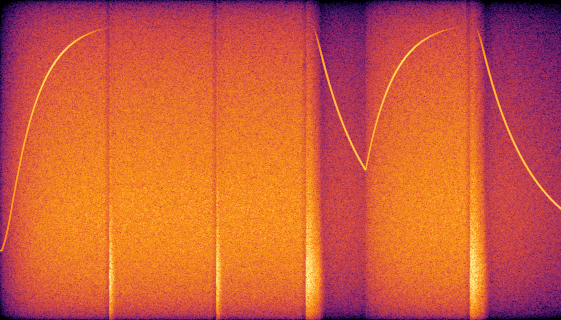 | 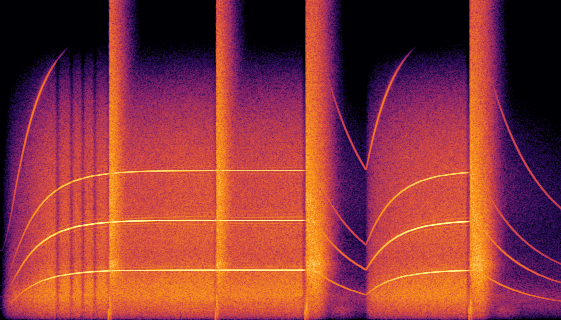 |

### vw-saveiro-gl-1994/preset:vw-saveiro-marcos-turbo-sandbox

| Antes (legado) | Depois (2.0) |
|---|---|
| 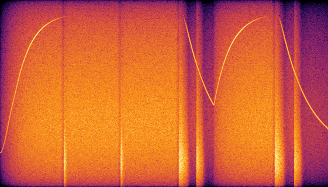 | 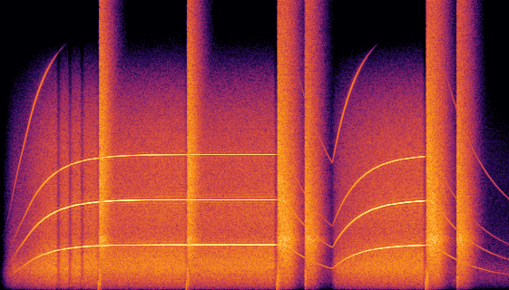 |

### bmw-320i-f30-2014/stock

| Antes (legado) | Depois (2.0) |
|---|---|
| 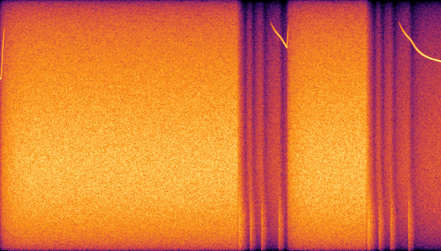 | 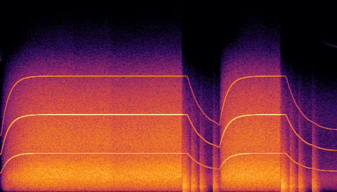 |

### honda-civic-si-2008/conversion-s2

| Antes (legado) | Depois (2.0) |
|---|---|
| 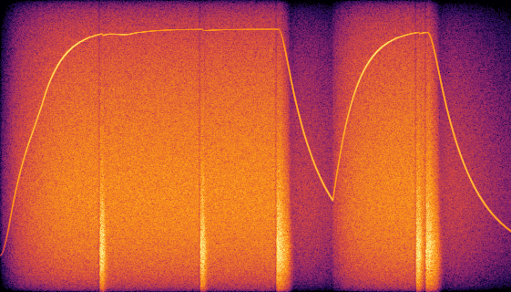 | 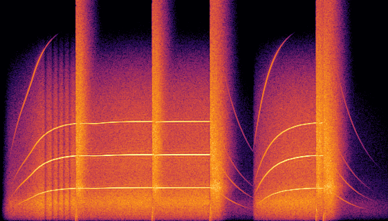 |

### mitsubishi-evo-x-2012/stock

| Antes (legado) | Depois (2.0) |
|---|---|
| 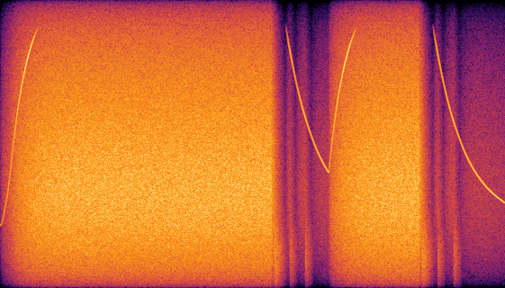 | 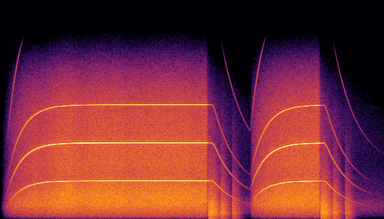 |

### nissan-370z-2014/conversion-s2

| Antes (legado) | Depois (2.0) |
|---|---|
| 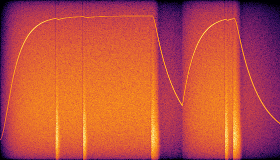 | 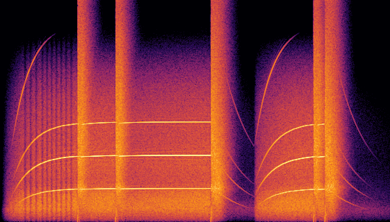 |

### nissan-gtr-r35-2015/stock

| Antes (legado) | Depois (2.0) |
|---|---|
| 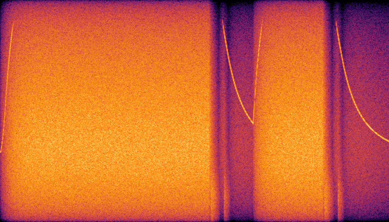 | 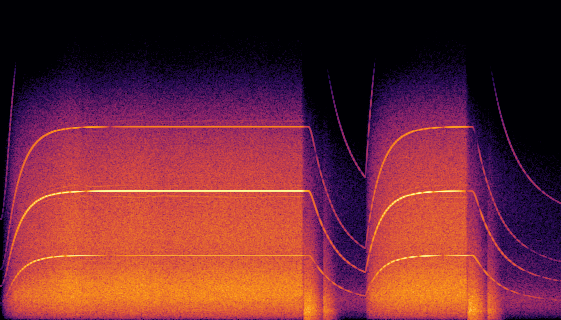 |

